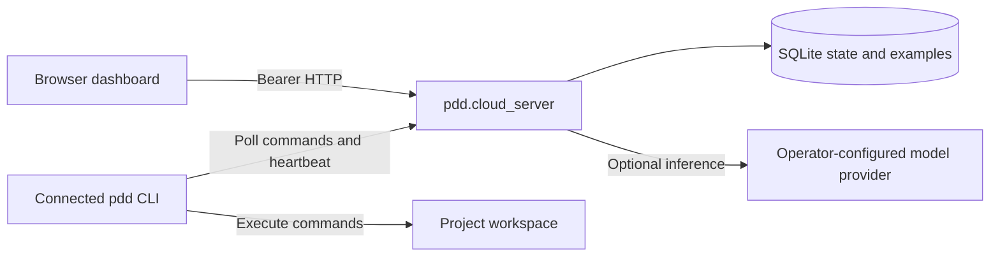

# Local operation and self-hosting

Use the fork locally, or run its optional server under `pdd.cloud_server`.
The CLI retains its HTTP endpoint names and replaces vendor login with bearer tokens.

## Build the checkout

Use Python 3.12+, uv >=0.12, and the Bun version in `pdd/frontend/.bun-version`.

```sh
uv sync --locked --extra dev
(cd pdd/frontend && bun ci && bun --bun run build)
uv build
```

The wheel includes the server and built frontend. Build the frontend before packaging.
Generated frontend files stay outside Git. A source checkout needs the same build step.
Use this checkout's `.venv/bin/pdd` or install its wheel; the published package is upstream.

## Run locally

From the project you want to work on:

```sh
/path/to/pdd/.venv/bin/pdd --local connect --local-only
```

The local UI runs on port 9876. It requires neither service credentials nor a cloud session.
`--local` controls model routing. `--local-only` controls relay registration.
Model-provider API keys and agent CLI logins remain separate from service authentication.
For offline inference, configure a local model through the existing model catalog.

## Start the service

Generate a private token file. Use the same token for the service and its clients.

```sh
umask 077
.venv/bin/python -c 'import json, secrets; print(json.dumps({"sabino": secrets.token_urlsafe(48)}))' > server-tokens.json
export PDD_SERVER_TOKENS_FILE="$PWD/server-tokens.json"
export PDD_SERVER_DATABASE="$PWD/server-data/state.sqlite3"
.venv/bin/pdd-cloud-server --host 127.0.0.1 --port 9877
```

Keep the token file and database outside version control.
Supply provider credentials to this process if you want server-side model inference.
The relay works without provider credentials because commands run on the connected machine.

On the machine running your project, configure its token as a plain-text file:

```sh
export PDD_CLOUD_URL=http://127.0.0.1:9877
export PDD_CLOUD_TOKEN_FILE=/private/path/to/client-token
/path/to/pdd/.venv/bin/pdd auth status --verify
/path/to/pdd/.venv/bin/pdd connect
```

Open `http://127.0.0.1:9877/cloud` and enter the same token.
Select the connected machine and submit a command. The dashboard defaults to local inference.
Use arguments `{"args":["--help"]}` and command `sync` for a harmless relay check.
The browser holds the token in memory; reloading clears it.



## Configuration

| Variable | Purpose | Default |
| --- | --- | --- |
| `PDD_SERVER_TOKENS_FILE` | JSON object mapping stable owner names to tokens | Required unless single token is set |
| `PDD_SERVER_TOKEN` | Single-owner token, at least 32 characters | Unset |
| `PDD_SERVER_DATABASE` | SQLite file | `~/.pdd/cloud_server.sqlite3` |
| `PDD_SERVER_PUBLIC_URL` | URL used in returned dashboard links | CLI host and port |
| `PDD_SERVER_ALLOWED_ORIGINS` | Comma-separated browser origins | `http://127.0.0.1:9876,http://localhost:9876` |
| `PDD_SERVER_SESSION_TIMEOUT` | Heartbeat age before a session becomes stale | 120 seconds |
| `PDD_SERVER_EXAMPLE_LIMIT` | Retrieved examples per inference request; zero disables retrieval | 3 |
| `PDD_CLOUD_URL` | Explicit client service base URL | Empty, local mode |
| `PDD_CLOUD_TOKEN_FILE` | Plain-text client bearer token, reread on each lookup | Unset |
| `PDD_CLOUD_TOKEN` | Client bearer token; takes precedence over token file | Unset |
| `PDD_CLOUD_TIMEOUT` | Client inference request timeout | 900 seconds |
| `PDD_AUTO_SUBMIT_EXAMPLES` | Explicit opt-in for successful sync uploads | Disabled |
| `PDD_AUTO_UPDATE` | Explicit opt-in for upstream update checks | Disabled |

`PDD_JWT_TOKEN` remains a compatibility alias after URL configuration.
Existing GitHub authentication still serves GitHub commands. It grants no service access.
Firebase settings and old JWT caches do not enable this fork's remote adapters.
The legacy OAuth helper modules remain available to extensions, outside the CLI and UI authentication paths.

## Operate your deployment

Terminate HTTPS at a reverse proxy and expose the service there.
Keep each project server bound to loopback; the client polls outward through the relay.
Set `PDD_SERVER_PUBLIC_URL` to the externally reachable service URL.
Add exact browser origins when the local UI uses a different host or port.
Serve the dashboard and API at the origin root.

Treat tokens as permission to control their owner's connected machines and use server model credentials.
Use separate stable owners for separate users. All authenticated users can see explicitly shared examples.
Rotate server tokens by editing the token file and restarting the service.
Update client token files before retrying. Changing owner names changes access to stored state.

SQLite suits one service instance with local persistent storage. Use one CLI worker per registered session.
Back up SQLite through its backup API or stop the service before copying its files.
Sessions, command outputs, and examples persist until the operator removes their data.
Do not automatically replay processing commands after a worker crash; cancel them and inspect before resubmitting.

Examples are private by default. `metadata.isPublic=true` shares with authenticated service users.
Uploads deduplicate by owner and content. Retrieval uses SQLite FTS5 lexical matching and language filtering.
The server treats caller preprocessing directives as text. Expand workspace context on the client.
Generated code and tests execute on the connected machine, outside the inference API.

## Compatibility and validation limits

Contracts come from public clients at upstream commit `b2ceb65774c65c4056f48cd8b108822c20d0f0c9`.
They do not establish equivalence with the unavailable vendor backend.
The [API reference](cloud-server-api.md) and [OpenAPI snapshot](cloud-server-openapi.json) describe the implemented contract.

`syncState` and `trackUsage` return 501 because no public caller defines their payloads.
`getCreditBalance` reports billing disabled. Provider costs remain payable to your provider.
No marketplace, hosted GitHub automation service, subscriptions, or credit accounting is implemented.

Service tests block network access and mock model calls. Relay behavior also passes a live CLI/browser help-command check.
Real provider inference and external deployment are separate validation steps.
The legacy frontend has seven whole-project TypeScript errors; strict checks cover the service UI and shared API.
